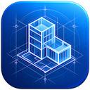

<p align="center"></p>

<h1 align="center">BIMDesign</h1>

<p align="center">Modelagem da informação da construção no navegador. Uma alternativa de código aberto ao Autodesk Revit, ArchiCAD e Vectorworks.</p>

> **Versão alfa inicial.** Os recursos podem mudar e os dados do projeto podem ser perdidos. Ainda não confie ao BIMDesign projetos reais e mantenha cópias dos trabalhos importantes.

BIMDesign representa edifícios com elementos reais organizados por pavimentos: paredes com várias camadas, portas e janelas que abrem os respetivos vãos, pisos, forros, coberturas, pilares, vigas, escadas, rampas, guarda-corpos, mobiliário e equipamentos, além de ambientes com medições automáticas. Todas as vistas são geradas a partir do mesmo modelo, pelo que uma alteração numa planta também se reflete nos cortes, nas elevações, na vista 3D, nas tabelas e nas pranchas.

O programa funciona inteiramente no navegador e não precisa de conta nem de ligação à Internet. Os ficheiros de projeto são abertos e guardados neste dispositivo.

### Utilização offline

Abra diretamente o ficheiro `index.html` (`file://`) ou execute o programa num servidor local; o BIMDesign não contacta serviços externos. Os projetos são guardados como ficheiros `.bdp` através do seletor de ficheiros do dispositivo ou descarregados, caso o navegador não permita a gravação direta. Uma cópia de recuperação local no navegador ajuda a restaurar o trabalho após recarregar a página, mas não substitui a gravação do ficheiro do projeto. Mantenha cópias dos projetos importantes.

Mantenha juntos os ficheiros da pasta transferida, incluindo `bundle.js`. Este ficheiro JavaScript clássico permite executar a aplicação com `file://`, sem as restrições do navegador aos módulos ES. Sempre que alterar os ficheiros de origem, volte a gerar o bundle com `node build-bundle.cjs`.

## Funcionalidades

**Modelação**
- Paredes desenhadas em sequência, em retângulos ou ao longo de linhas selecionadas, com escolha da linha de referência (eixo, face exterior ou interior), restrições de base e topo e introdução de comprimentos. As paredes ligam-se corretamente em cantos, junções em T e nós com várias paredes; as camadas (acabamento, estrutura, isolamento, caixa de ar, entre outras) são apresentadas em detalhe na planta.
- Paredes cortina com grelha regular de montantes e painéis de vidro.
- Portas (simples, duplas, de correr, de correr embutidas, bifold, de garagem e vãos sem porta) e janelas (fixas, de batente, de guilhotina, de correr, projetantes e panorâmicas) inseridas em paredes, com controlos de abertura e orientação. Vãos retangulares em paredes.
- Pisos e forros criados a partir de um ambiente ou do contorno do edifício selecionado, de um retângulo ou de um contorno desenhado. Coberturas definidas por pendentes em cada aresta: de quatro águas, de duas águas ou de uma água, geradas a partir do mesmo modelo.
- As paredes podem ficar ligadas a uma cobertura e acompanhar as alterações à sua forma.
- Aberturas de caixa que atravessam pisos, forros e coberturas ao longo de vários pavimentos.
- Pilares, vigas, escadas retas, em L e em U com número automático de espelhos, patamares e corrimãos; rampas com largura, espessura e pavimento de chegada (ou altura definida); e guarda-corpos.
- Biblioteca de mobiliário, armários, louças sanitárias, eletrodomésticos, plantas e iluminação. O mobiliário colocado junto a uma parede fica orientado com a parte posterior virada para ela.
- Ambientes colocados manual ou automaticamente, delimitados por paredes, pilares e linhas separadoras, com cálculo em tempo real de área, perímetro e volume.
- Pavimentos e grelhas de eixos.

**Edição**
- Seleção por clique, janela (da esquerda para a direita) ou cruzamento (da direita para a esquerda); use Tab para percorrer elementos sobrepostos e selecione todas as instâncias.
- Arraste para mover (as paredes ligadas mantêm as ligações; as portas deslizam ao longo da parede ou podem ser movidas para outra), utilize os pontos de controlo nas extremidades das paredes, nos cantos das lajes e nas linhas de corte, inverta a orientação e edite cotas temporárias.
- Mover, copiar, rodar, espelhar (por seleção ou desenho de um eixo), criar matrizes, alinhar, deslocar, aparar/estender até um canto ou referência, dividir, fixar, igualar tipo, copiar e colar.
- Ajustes a objetos (extremidades, pontos médios, interseções, perpendicularidade e ponto mais próximo), incrementos de ângulo e comprimento e alinhamento com pontos próximos.
- Anular e refazer todas as operações.

**Vistas e documentação**
- Plantas de pavimento e de forro com plano de corte, nível de detalhe, sobreposição do pavimento inferior, preenchimento colorido dos ambientes e controlo da visibilidade de categorias e elementos em cada vista.
- Vistas 3D com cubo de orientação, órbita, projeção em perspetiva ou ortográfica, caixa de corte e cinco estilos visuais.
- Elevações e cortes gerados a partir do modelo, com preenchimento dos elementos cortados e anotação de pavimentos e grelhas.
- Cotas alinhadas que acompanham as paredes medidas, texto, etiquetas, linhas de detalhe e regiões preenchidas.
- Tabelas de portas, janelas, ambientes, paredes, pisos, mobiliário, pilares e escadas, com seleção de campos, ordenação, agrupamento, totais, edição direta e exportação CSV.
- Pranchas com legenda e vistas colocadas.
- Ocultar e isolar temporariamente, revelar elementos ocultos e apresentar linhas finas.

**Ficheiros**
- Projetos (`.bdp`) abertos e guardados neste dispositivo; cópias locais de recuperação ajudam a preservar o trabalho após recarregar a página.
- Importe desenhos DXF para uma planta, corte ou prancha como linhas de detalhe e texto, para os decalcar ou anotar.
- Exporte para IFC (IFC4, compatível com outros programas BIM), glTF e OBJ (3D), DXF (plantas), PDF, SVG e PNG (desenhos e pranchas) e CSV (tabelas).

**Interface**
- Faixa de opções com separadores contextuais, barra de opções, painel Propriedades com seletor e editor de tipos (incluindo estruturas de camadas de paredes, pisos, coberturas e forros), Navegador de Projeto, separadores de vistas, barra de controlo da vista e barra de estado.
- Atalhos de teclado de duas letras (por exemplo, WA para parede, DR para porta, WN para janela e MV para mover), pesquisa de comandos (Ctrl+K), menus de contexto e navegação completa pelos painéis com o teclado.
- Temas claro, escuro e do sistema. Compatível com rato, trackpad, toque e teclado, em computadores, tablets e telemóveis.

## Como começar

1. Crie um projeto métrico ou imperial no ecrã inicial, ou abra a casa de exemplo.
2. Desenhe paredes com **Parede** (WA). Clique para iniciar e volte a clicar para terminar cada segmento; introduza um número para definir o comprimento. Prima Esc para terminar a sequência.
3. Adicione portas (DR) e janelas (WN) movendo o cursor sobre uma parede. Prima Espaço para inverter a orientação.
4. Crie um **Piso** ou uma **Cobertura** clicando numa parede do edifício e, em seguida, em **Concluir**.
5. Use **Rampa** (RA), clique no início e no fim da projeção em planta e ajuste a largura, a espessura e o pavimento de chegada na barra de opções.
6. Coloque ambientes (RM) e abra uma **Vista 3D**, elevação ou corte no Navegador de Projeto.

Navegação: a roda do rato amplia ou reduz em torno do cursor; o botão do meio desloca a vista. Em 3D, arraste com o botão direito (ou com Shift e o botão do meio) para orbitar. Em ecrãs táteis, use o gesto de pinça para ampliar ou reduzir, arraste com dois dedos para deslocar e com um dedo para orbitar em 3D. Prima F1 para consultar a ajuda e os atalhos.

## Desenvolvimento

```sh
npm install
npm run dev        # http://localhost:5173/
npm test           # unit tests (Vitest)
npm run build      # production build in dist/
```

Abra `/?sample` para iniciar com a casa de exemplo.

### Arquitetura

| Área | Localização | Descrição |
|---|---|---|
| Documento | `src/core/doc.js` | Armazenamento único de elementos imutáveis (elementos, tipos, vistas e materiais), com transações, pré-visualizações, anulação e repetição. |
| Lógica do modelo | `src/core` | Ligações entre paredes (`walls.js`), limites dos ambientes calculados a partir de uma estrutura planar (`rooms.js`), coberturas de contorno calculadas como envelope inferior de planos inclinados (`roof.js`), escadas, famílias procedimentais, tabelas e pranchas. Sem dependência de frameworks e com testes unitários. |
| Geometria | `src/core/build3d.js`, `src/core/plan.js` | Cada elemento gera uma malha 3D com arestas características e gráficos de planta (preenchimentos de corte com padrões de hachura, espessuras de linha, tracejados e texto) para a vista em que é apresentado. |
| Cena | `src/core/scene.js` | Guarda em cache as malhas e os gráficos de planta de cada elemento e só os reconstrói quando uma edição os afeta, comparando os dados de entrada de cada resultado. |
| Renderização | `src/render` | WebGL2. Plantas: linhas instanciadas e antisserrilhadas com espessuras e padrões de tracejado, preenchimentos hachurados desenhados em camadas a partir de buffers GPU segmentados. 3D: malhas segmentadas, arestas projetadas no ecrã, planos de corte, transparência e seleção por GPU. Uma textura de estado por elemento gere seleção, passagem do cursor, ocultação e meio-tom sem alterar a geometria. |
| Vistas | `src/views` | Controladores de plantas, vistas 3D/elevações/cortes, tabelas e pranchas; um canvas WebGL partilhado e uma sobreposição 2D para texto e indicações. |
| Edição | `src/editor` | Ferramentas, ajustes, pontos de controlo e cotas temporárias. |
| Interface | `src/ui` | Sem framework: faixa de opções, painéis, diálogos e menus. |
| Ficheiros | `src/io` | Ficheiros de projeto locais, recuperação no navegador e geração de IFC, glTF, OBJ, DXF, PDF e SVG. |

Os comprimentos são guardados internamente em milímetros e apresentados nas unidades do projeto. As definições são guardadas localmente neste navegador; os ficheiros de projeto são guardados neste dispositivo.

## Licença

Este repositório, incluindo todo o seu conteúdo, subprojetos, módulos e componentes, é distribuído ao abrigo da licença [MIT](../../LICENSE), salvo indicação em contrário. As bibliotecas de terceiros incluídas neste repositório podem estar sujeitas às respetivas licenças.

Bibliotecas de terceiros: [earcut](https://github.com/mapbox/earcut) (ISC) e ícones [Lucide](https://lucide.dev) (ISC).
